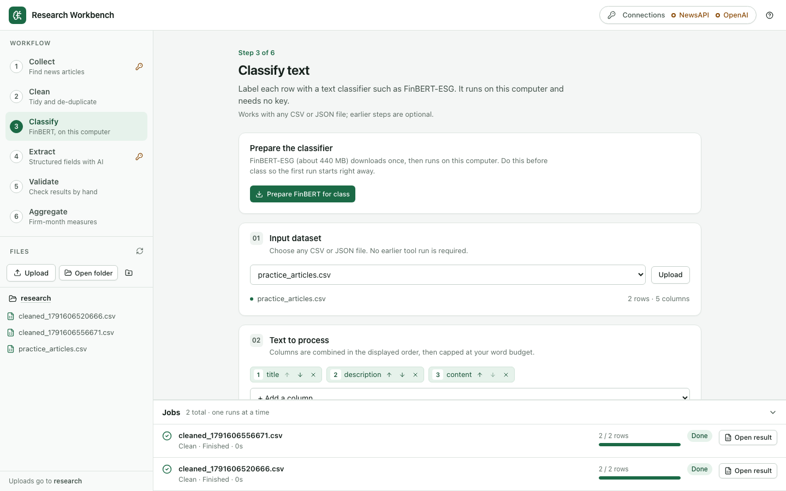
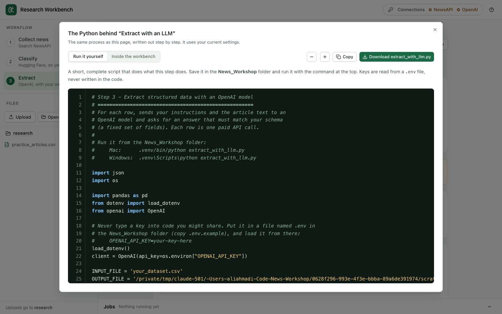

# Research Workbench

A classroom workbench for three research steps: **collect** news articles with NewsAPI, **classify** them with a Hugging Face model, and **extract** structured data with an LLM. It runs on each student's own computer and opens in the browser, and every step can show the Python code behind it. Every student enters **their own** API keys, which stay on their computer.

## Student quick start

**Mac (Apple Silicon)** — open Terminal and paste:

```sh
curl -LsSf https://raw.githubusercontent.com/TheAliAhmadi/News_Workshop/main/scripts/install.sh | bash
```

**Windows 10/11** — open PowerShell and paste:

```powershell
powershell -ExecutionPolicy Bypass -c "irm https://raw.githubusercontent.com/TheAliAhmadi/News_Workshop/main/scripts/install.ps1 | iex"
```

That downloads the project to a `News_Workshop` folder in your home folder, sets up Python and all packages inside it (first time: a few minutes), and opens the workbench in your browser. Nothing needs to be installed beforehand.

**Prefer to let an AI assistant do it?** If you use an AI coding assistant that can run commands on your computer (Claude Code, Codex, Cursor's agent, or GitHub Copilot in Agent mode), copy this prompt into it:

```text
Set up and start the Research Workbench from https://github.com/TheAliAhmadi/News_Workshop on this computer.

1. Check my computer first. It needs a Mac with Apple Silicon (M1 or newer) or 64-bit Windows 10/11. If it is anything else, stop and tell me.
2. Run the project's official installer, exactly as written, in the background, because it keeps running once the workbench starts:
   - Mac: curl -LsSf https://raw.githubusercontent.com/TheAliAhmadi/News_Workshop/main/scripts/install.sh | bash
   - Windows (PowerShell): powershell -ExecutionPolicy Bypass -c "irm https://raw.githubusercontent.com/TheAliAhmadi/News_Workshop/main/scripts/install.ps1 | iex"
   It downloads the project into a News_Workshop folder in my home folder and installs everything it needs inside that folder. The first run takes a few minutes.
3. Watch its output. When it prints "Research Workbench is ready at http://127.0.0.1:...", give me that address, open it in my browser if you can, and leave the workbench running.
4. If a step fails, show me the exact message (lines starting with "Setup stopped" explain what went wrong) and explain it in plain words. Do not change the project's code, and do not install anything else on my computer without asking me.

Never ask for, read, or type my API keys. I will add them myself in the workbench under Connections.
```

**Using Git instead?** Fork or clone this repository, then double-click **Start Workbench.command** (Mac) or **start.bat** (Windows) in the project folder.

**Next time:** double-click the same start file. Keep its window open while you work; closing it stops the workbench.

Then:

1. Enter your NewsAPI and/or OpenAI keys under **Connections**. **Remember on this computer** saves them in your system keychain or Credential Manager — never in the project files.
2. Optionally use **Prepare FinBERT for class** so the classifier downloads once.
3. Work through the three steps in the sidebar: **Collect news → Classify → Extract**. Each page starts with a flowchart of how the step works, and **Show the Python code** shows a script that does the same thing. Each step also works on its own with any CSV or JSON file.

Illustrated steps and troubleshooting: [Student guide](docs/student-guide.md).



## Prefer an installer?

The packaged desktop app is still available as an alternative to the quick start above.

### Download for Mac

[**Download for Mac**](https://github.com/TheAliAhmadi/News_Workshop/releases) — Apple Silicon, macOS 14 or newer
File: `ResearchWorkbench-*-macOS-arm64.dmg`

Open the disk image and drag **Research Workbench** into Applications. This is an **unsigned preview**; follow the [first-opening instructions](docs/student-guide.md#opening-the-unsigned-preview) if your computer asks for approval.

### Download for Windows

[**Download for Windows**](https://github.com/TheAliAhmadi/News_Workshop/releases) — Windows 11, 64-bit
File: `ResearchWorkbench-*-Windows-x64-Setup.exe`

Run the setup file. It installs for your user account only. The unsigned preview may show a Windows publisher warning; see the [first-opening instructions](docs/student-guide.md#opening-the-unsigned-preview).

If the Releases page has no assets yet, the first packaged build has not been published—use the [student quick start](#student-quick-start) meanwhile, or wait for a draft release from the Actions workflow.

Intel Macs and native Windows on ARM are not included in this release. Classification runs on the CPU; no NVIDIA driver is required.

## Workflow steps

| Step | What it does |
| --- | --- |
| 1. Collect news | Combine a company name and unrestricted query with AND, choose suggested or discovered publisher domains, and save raw Everything results. |
| 2. Classify | Choose any CSV/JSON dataset, order the text sections, select a compatible classifier, and save original columns with native labels, scores, exact input, revision, and truncation metadata. |
| 3. Extract | Describe any extraction task in Design with AI to generate and refine instructions, enums, and a nested schema, or edit them yourself. Choose a dataset and model, test one row, then process selected rows. |

Every step page shows a live flowchart of where the data goes (on your computer or over the internet), and a **Show the Python code** button with two views: a short, commented script built from the current settings that students can download and run, and the workbench's own backend functions for that step.



## Connections and data locations

Keys entered in **Connections** stay on the computer. Remembered credentials use macOS Keychain or Windows Credential Manager through `keyring`. If secure storage is unavailable, keys remain session-only and the interface says so; plaintext keys are never saved silently.

When started with `start.sh` / `start.bat`, everything lives inside the project folder and is git-ignored, so it is never committed or overwritten by updates:

- Research files → `research_workspace/` (other folders can be attached in the app)
- Settings, jobs, and checkpoints → `.workbench/`
- Python environment → `.venv/`; model downloads → `.cache/huggingface/`

The desktop installers use per-user application-data and cache folders instead, with research files in `~/ResearchWorkbench`.

NewsAPI and OpenAI require your own accounts. The app uses [NewsAPI Everything](https://newsapi.org/docs/endpoints/everything). The default classifier is [yiyanghkust/finbert-esg](https://huggingface.co/yiyanghkust/finbert-esg).

## Development (instructors and contributors)

`./start.sh` (or `start.bat`) is the whole setup for running. For development:

```sh
uv pip install --python .venv/bin/python -r requirements-dev.txt

# Interface (Node.js 20.9+). Students use the committed build in frontend/out,
# so rebuild and commit it after any interface change; CI checks it is current.
cd frontend && npm ci && npm run build && cd ..
```

Copy `.env.example` to `.env` for local keys during source-based use. `.env` is git-ignored; never commit keys. Packaging scripts live under `packaging/`; see [publisher signing](docs/publisher-signing.md) before publishing installers.

```sh
.venv/bin/python -m pytest -q
cd frontend && npm run typecheck && npm run build
```

Browser tests: start the local app, then `npx playwright install chromium && npm run test:e2e` in `frontend/`. See [verification](docs/verification.md), [instructor guide](docs/instructor-guide.md), and [architecture](docs/architecture.md).

## Releases

GitHub Actions builds Mac and Windows packages and opens a **draft** release with installers, checksums, and third-party notices. Public student downloads wait until installers are [signed and verified](docs/publisher-signing.md). The release plan is in [docs/history/PLAN_release.md](docs/history/PLAN_release.md).
